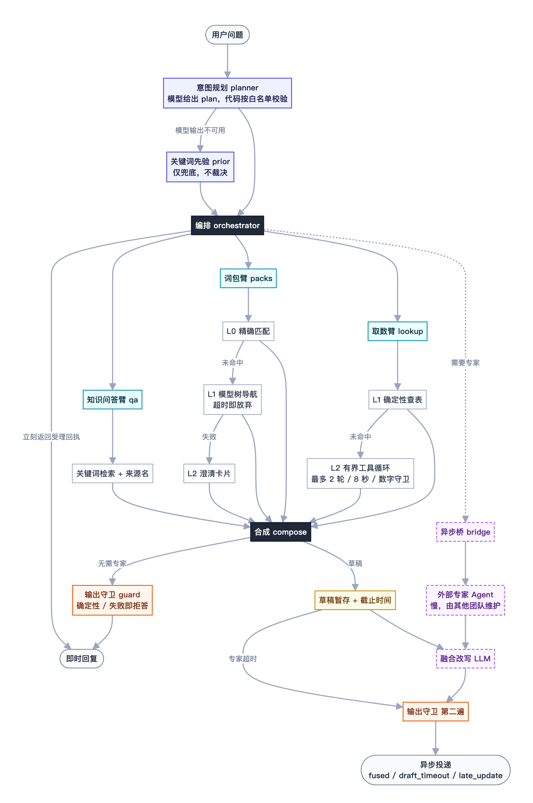
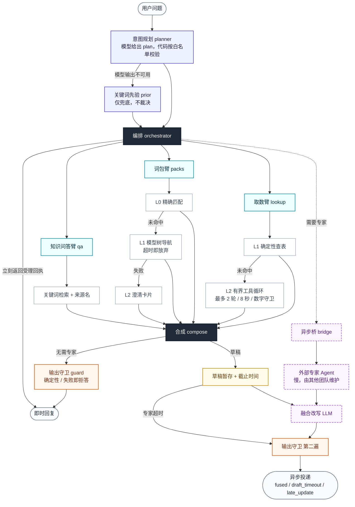

# 架构说明

通用的分层问答 Agent 参考架构。数据与场景均为虚构，不对应任何公司系统。

## 总览图

> 上图由下方的 Mermaid 源码导出（`architecture.png`），颜色按层区分：靛蓝为规划、深色为编排与合成、青色为三条能力臂、灰白为逐级兜底、橙色为守卫、紫色虚线为跨团队异步链路。

## 组件

| 组件 | 职责 | 用不用模型 | 失败时 |
|---|---|---|---|
| planner | 判断需要哪几类能力 | 是 | 退回关键词先验 |
| lookup L1 | 类目、渠道、目标命中就直接查表 | 否 | 进 L2 |
| lookup L2 | 模型补全未解析的维度，最多 2 轮 | 是 | 列出可选类目 |
| packs L0/L1/L2 | 精确匹配、模型导航、澄清 | L1 用 | 澄清卡片 |
| qa | 关键词检索，返回段落与来源 | 否 | 返回“未找到” |
| bridge | 异步调用外部专家，立即返回回执 | 否 | 草稿到期后发出 |
| delivery | 暂存草稿、融合、去重、超时兜底 | 融合用 | 发草稿 |
| guard | 删除敏感列、名单表、敏感句，再校验 | 否 | 返回拒答文案 |

## 请求流程

**同步路径**：规划 → 运行各臂 → 合成 → 守卫 → 返回。

**异步路径**（plan 含 external）：规划 → 运行本地臂 → 合成本地草稿 → 提交专家并立即返回回执
（含 ref）→ 专家答复到达后，草稿与答复融合成一条 → 守卫 → 投递。专家超时则发送草稿。
同一个 ref 只会发送一次；专家在草稿发出后才到达，则作为 `late_update` 单独发送。

## 可观测

每次回复带 `trace`：plan 与来源（llm / prior）、各臂的层级（L0/L1/L2）与耗时、守卫命中项。
