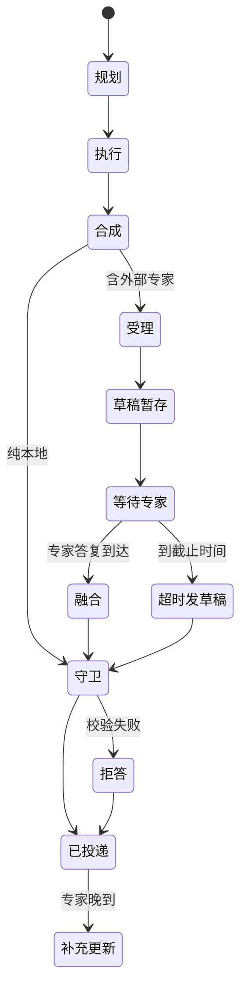

# 产品设计

> 一个入口，承接四类问题：查基准、找术语、查规则、问策略。
> 设计主线：把不确定性挡在用户之外——能确定的立刻答，不能确定的先受理、后回答，答不了就明确拒答。

---

## 1. 设计目标

| 目标 | 含义 | 反例 |
|---|---|---|
| **答案可信** | 数字照原样、规则给原文、结论带来源 | 模型“顺手”补一个数 |
| **等待可预期** | 慢问题先回执，最终只发一条回复 | 用户等 3 分钟，不知道有没有人接 |
| **失败可解释** | 答不了就拒答或澄清，不拼凑 | 半句正确、半句编造 |
| **成本可控** | 确定性路径优先，模型只处理残余 | 每个问题都走一遍大模型 |

这四条不是并列的：**可信**优先级最高，其次是**可预期**，再次才是成本。冲突时按这个顺序取舍（例如：宁可多调一次模型，也不让数字被改写）。

---

## 2. 用户与任务

| 用户 | 典型问题 | 真正想要的 | 失败的代价 |
|---|---|---|---|
| 一线运营 | 某行业 CPM / CTR 是多少 | 一个能直接写进方案的数，且知道口径与周期 | 数错了，整份投放方案返工 |
| 一线运营 | 这个类目有哪些可用术语 / 关键词 | 能直接拿去用的清单；类目不清时希望被问一句 | 词不相关，投放白跑 |
| 一线运营 | 账户命中黑名单后，余额还能退吗 | 规则原文和出处，方便对外沟通 | 口径说错，对外承诺无法收回 |
| 策略同事 | 这笔预算怎么分 | 一个有人负责的判断；可以等，但要知道“已经在处理” | 等太久，错过决策窗口 |

两类用户的差异不在职级，而在**对延迟的容忍度**：一线运营要即时，策略同事可以等，但不能空等。

### 2.1 三个典型场景

> 以下场景来自脱敏后的真实提问，只保留问题形态与处理结果，不逐条对应原始记录。

**行业基线查询**：代理商运营在群里问“某行业各细分业务类型的日均消费、CPM、CTR、CPA 是多少”。系统先回受理语并给编号；数据返回后给一张带口径的表。如果该行业没有数据，明确说“没有拿到”，不拿相近行业补一个数。记录里这类数据与成本问题约占 18%，是最常见的一类。

**账户与政策口径**：客户追问“账户命中黑名单后，余额还能退吗”。系统走知识问答，返回规则原文与来源；知识库里没有时明确说“未找到”，不用旧版本或相近规则顶替。记录里规则与资质类问题约占 6%，但答错的对外代价最高。

**多意图行业咨询**：有人把“某行业的具体应用场景、发展潜力、转化成本，以及需要加哪些无关否词”塞进一个问题。系统拆成行业分析、数据查询、否词建议三条路并行执行；缺数据的部分单独说明，不把三件事混成一段泛泛而谈。

这三个场景分别对应后面的查基准、查规则、问策略三条路径；找术语嵌在第三个场景里，作为投放前的准备动作。

---

## 3. 为什么不是一个通用 RAG

四类问题在三个维度上不同：

| 问题类型 | 答案形态 | 确定性 | 延迟 / 风险 |
|---|---|---|---|
| 查基准 | 结构化数值 | 高，可查表 | 毫秒级；错一个数代价最大 |
| 找术语 | 半结构化清单 | 中，有树可导航 | 秒级；词不相关代价高 |
| 查规则 | 非结构化原文 | 中，可检索 | 秒级；漏引来源代价高 |
| 问策略 | 判断与建议 | 低，需要专家 | 分钟级；空等代价高 |

统一 RAG 会同时犯两个错：

1. 把本来可以查表的问题交给模型——更慢，还可能改写数字；
2. 把需要人判断的问题塞进同步链路——用户在前台空等。

**决定**：先判断问题类型，再选路径。规划由模型给出、代码按白名单校验；模型不可用时退回关键词先验，只兜底、不裁决（见 [PD-01](product-decisions.md#pd-01-先判断问题类型再选路径)）。

---

## 4. 能力与路径

| 能力 | 用户看到什么 | 内部路径 | 失败时 |
|---|---|---|---|
| **查基准** | 数值 + 口径 + 周期 | L1 确定性查表 → L2 有界工具循环 | 列出可选项，请用户确认类目 |
| **找术语** | 一组术语 / 关键词 | L0 精确匹配 → L1 模型树导航 → L2 澄清卡片 | 给可点选的澄清卡片 |
| **查规则** | 规则原文 + 来源文件 | 轻型 RAG（向量 + BM25 + 关键词，RRF）→ 低置信升级重型 RAG（改写 + 重排 + 多跳） | 明确返回“未找到” |
| **问策略** | 受理回执 + 稍后一条完整回复 | 本地草稿 + 外部专家异步融合 | 专家超时则发送草稿 |
| **安全兜底** | 固定拒答文案 | 输出守卫，确定性校验 | 任何残留都拒答 |

每条路径都遵循同一个原则：**先便宜、后昂贵；先确定、后模型；最后才是澄清或拒答。**

---

## 5. 关键流程

### 5.1 同步：一次问、一次答

适用于查基准、找术语、查规则。

```
提问 → 规划 → 执行各臂 → 合成 → 输出守卫 → 一次回复
```

用户只收到一条回复；回复里包含结论、口径和来源。守卫不通过时，用固定文案拒答，不返回“半成品”。

### 5.2 异步：先回执、后回答

适用于问策略，或需要外部专家的问题。

```
提问 → 规划 → 本地各臂 → 合成草稿 → 立即返回回执（带 ref）
                                      ↓
                              草稿暂存 + 截止时间
                                      ↓
                    专家答复到达 → 融合改写 → 守卫 → 投递
                    到截止时间   → 直接投递草稿（标注“初稿”）
```

三个约束：

- **回执必须立刻给**，并带一个可引用的编号；
- **最终只发一条**，专家答复与草稿融合后再发，避免两条口径冲突；
- **专家晚到**时，作为“补充更新”单独发送，不重发整条答案。

### 5.3 澄清：收敛口径，不让用户重述

当类目、对象或口径无法唯一确定时，先收敛口径：能枚举就给 2–4 个可点选项；不能枚举就说明缺哪个维度，并给出可替代的问法。

```
“某行业大盘数据” 缺少地域、媒体、指标、周期。
可以改问：“某城市、某媒体、近 30 天的日均消费和 CPM。”
```

澄清一次为限；用户仍不选时，按最接近的默认口径回答，并注明假设。

### 5.4 拒答：固定文案，不解释规则

命中不可披露的数据、名单表或敏感模式时，直接返回固定文案：

> 这个问题涉及不可披露的信息，无法回答。

记录里的拒答通常还会补一句可替代的问法，例如把“行业大盘数据”收敛到“各细分行业、业务类型的水位指标”。可以给替代方向，但不解释触发了哪条规则，也不提供“删减版”——残缺答案比没有答案更容易被误用。

### 5.5 补充更新：专家晚到的展示

专家在草稿发出后才返回时，作为一条独立消息发送：

> 【补充更新 · 编号 R-1042】专家意见已返回：……

编号与首次回执一致，用户能对上；不重新回答整个问题。

---

## 6. 回复的信息结构

一条合格的回复包含四层：

| 层 | 内容 | 示例 |
|---|---|---|
| 结论 | 直接回答 | “某行业 CPM 为 ……（示例值）” |
| 口径 | 周期、行业层级、统计范围 | “2026-09，二级行业口径” |
| 依据 | 规则原文 / 清单 / 表格 | 原文段落，不改写 |
| 来源 | 文件名或数据表 | “来源：metrics.csv” |

不展示：内部排序权重、敏感列、规则命中明细、模型置信度分数。这些进入 `trace`，供内部排查，不进入用户回复。

---

## 7. 请求状态



对外可见的状态只有三种：**已受理（带 ref）**、**已回复**、**补充更新**。内部状态不暴露给用户。

---

## 8. 交互文案原则

1. 回执说清楚“在做什么、大概多久”，不给无法兑现的承诺；
2. 草稿必须标注“专家意见未到，以下为初稿”，不能伪装成最终结论；
3. 数字后面永远跟口径，规则后面永远跟来源；
4. 拒答不解释规则，澄清不超过一次；
5. 同一个问题不出现两条互相矛盾的最终回复。

---

## 9. 指标

| 指标 | 定义 | 用来判断 |
|---|---|---|
| 路由准确率 | plan 与人工标注一致的比例 | 规划是否可信（PD-01） |
| 各层命中率 | L0 / L1 / L2 各自解决的比例 | 确定性路径覆盖是否足够（PD-02） |
| 升级率 | 轻型 RAG 升级到重型 RAG 的比例 | 阈值是否合理（PD-08） |
| 澄清率 | 触发澄清的问题占比 | 意图与术语树是否缺失（PD-07） |
| 守卫触发率 / 拒答率 | 命中规则、最终拒答的比例 | 规则是否过严或上游数据有问题（PD-06） |
| 草稿超时率 | 到截止时间仍未收到专家答复的比例 | 专家可用性（PD-04） |
| 补充更新率 | 专家晚于草稿到达的比例 | 截止时间设置（PD-03） |
| 首响时延 / 终答时延 | 回执与最终回复的 P50 / P95 | 异步体验是否可预期（PD-03） |

指标不追求“越高越好”，而是用来定位**该升级没升级、该拒绝没拒绝**的边界。

---

## 10. 边界

本仓库是参考实现，不是生产系统：

- demo 只实现关键词检索，向量索引、BM25、RRF、重排、多跳均为链路设计；
- 不做多轮对话记忆、权限体系、真实专家 Agent 与持久化队列；
- 专家答复、知识库、指标数据全部为虚构。

这些边界本身也是产品决策，见 [PD-09](product-decisions.md#pd-09-明确不做什么把边界写进设计)。
